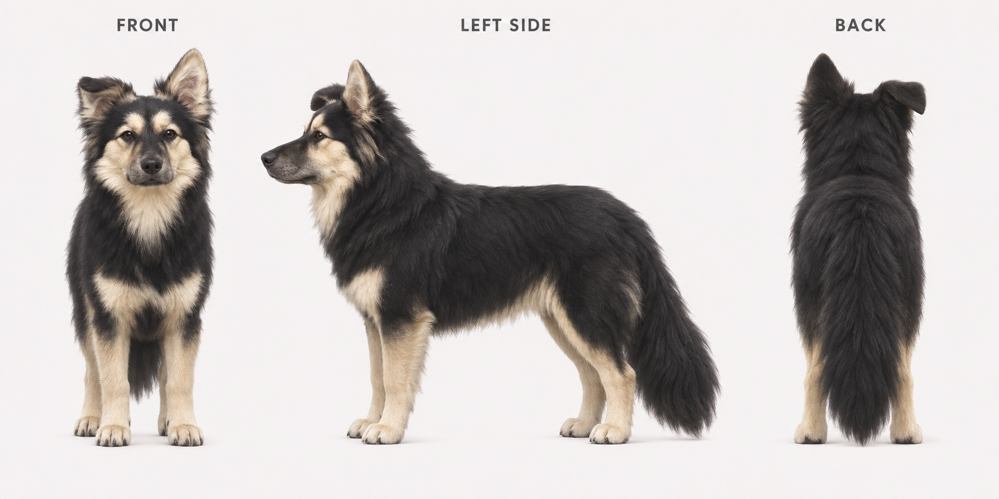
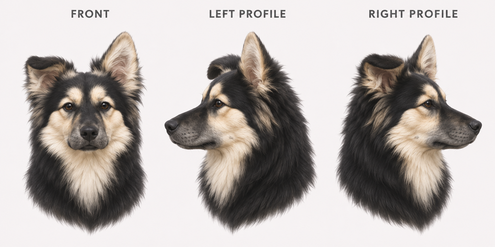

# 小黑｜完整宠物动画制作参考

本仓库收齐原始狗照片、三视图、单狗首帧、全部已交付提示词和历史宠物资料，供其他 AI 制作一套新的完整宠物动画。**新动画尚未制作；当前要使用的外形标准为照片版 `XH_REF_V1_PHOTO`。**

## 直接交给其他 AI

复制 [完整动画总提示词（连续一段）](prompts/full-animation.zh-CN.txt)，同时让 AI 读取本仓库的参考图。总提示词已经包含外形、全部动作、16 个视线方向、制作顺序和验收要求；它是给动画制作助手的任务说明，不是让视频模型在一个镜头里完成所有动作。

可以直接发送：

> 请读取这个仓库的 README.md、AGENTS.md 和 prompts/full-animation.zh-CN.txt，实际查看 assets/reference/ 中的参考图，再按总提示词分动作完成整套宠物动画；始终保留小黑的原有外形，不使用 archive/ 的旧版形象作为身份参考。

## 当前有效的参考图

| 图片 | 用途 |
| --- | --- |
| [原始照片](assets/reference/00-original-dog.jpg) | 核对真实外貌；照片背景不属于角色 |
| [站姿三视图](assets/reference/01-standing-three-views.png) | 正面、狗自身左侧面、背面；全身结构和毛色主参考 |
| [坐姿三视图](assets/reference/02-sitting-three-views.png) | 坐姿动作和背部姿态 |
| [脸与耳朵三视图](assets/reference/03-face-and-ear-three-views.png) | 正脸、左侧脸、右侧脸；脸型和不对称耳朵 |
| [单狗首帧](assets/reference/04-single-dog-first-frame.png) | 正面坐姿图生视频的起始帧 |

## 必须保留的身份

- 黑色中长毛；奶油色眉斑、脸颊、喉胸围脖、下肢和爪子；灰黑口鼻、黑鼻头、深棕眼睛。
- **狗自身左耳直立，右耳耳尖折下。正面左折右立，背面左立右折。** 左右奔跑要保持这种解剖关系，不能靠镜像交换两侧。
- 长而蓬松的黑尾，没有白尾尖，低垂或落地；不改成高卷尾。
- 沿用三视图的成年犬自然比例、脸型和半写实立体毛绒画风。

背面是根据原照补全后的统一设定，不是真实背面照片。三视图用于身份参考；图生视频的首帧应是单只狗，避免把三幅狗同时当作画面主体。

## 完整动画范围

九组状态：待机、向右奔跑、向左奔跑、挥爪、跳跃、失落、等待回应、工作思考、检查结果；另外制作 16 个顺时针视线方向。具体动作和建议交付格式见 [制作与验收清单](docs/animation-delivery.zh-CN.md)。

## 全部提示词和说明

- [一段式完整动画总提示词](prompts/full-animation.zh-CN.txt)
- [分项动作、角色建档、静帧、负面提示词及英文测试词](prompts/individual-actions.zh-CN.txt)
- [本次三视图和首帧的实际制作提示词](prompts/reference-generation.en.txt)
- [外形固定及跨工具使用说明](docs/identity-and-workflow.zh-CN.txt)
- [历史动画制作提示词](archive/legacy-v2/prompts/generation-prompts.txt)
- [全部图像的 SHA-256 清单](assets/manifest.json)

## 历史素材的边界

`archive/legacy-v2/` 保存早先已交付的预览、动作总览、GIF、精灵图和宠物配置，供追溯与布局参考。旧版有高卷尾等外形差异，**不能与本次参考图混作角色身份依据**。新动画输出放入 `animations/`，保留当前参考图原件。

有些 AI 不能直接读取仓库中的二进制图片；这种情况下要把上述图片下载并上传到该 AI 的参考图输入处，不能只发文件名。私有仓库还需要先授权访问。

本仓库提供制作任务与参考资料，不把提示词当成百分之百的身份锁定保证。制作中需实际检查；出现换狗、耳朵交换或毛色漂移时重做对应动作，不沿用错误帧继续扩散。
